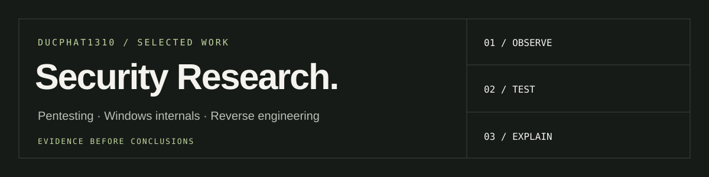

I study how systems fail, then turn observations into reproducible experiments
and clear remediation. My focus is **pentesting, Windows internals and reverse engineering**.

**[Explore the portfolio](https://ducphat1310.github.io/pentest-intern-portfolio/)**
&nbsp; / &nbsp; [Browse projects](https://github.com/ducphat1310?tab=repositories)

### Selected work

| Project | Question | Evidence |
| :-- | :-- | :-- |
| **[MIP-Q / NASim](https://github.com/ducphat1310/nasim-pentest-research)** | Can better action selection improve a simulated pentesting agent? | 192 archived runs, six scenarios, regression and integrity checks |
| **[Windows Minifilter Lab](https://github.com/ducphat1310/windows-minifilter-lab)** | Where does a file-access policy take effect in Windows? | C kernel callback, C++ client and PowerShell behavior check |
| **[.NET Security Case Study](https://github.com/ducphat1310/dotnet-security-case-study)** | What crosses the configuration, serialization and extraction boundaries? | Static findings, exploit preconditions, path validation and fixes |
| **[Rust Game Reverse Engineering](https://github.com/ducphat1310/rust-client-research)** | How do IL2CPP identity, native Unity data and capture timing interact? | Native byte checks, retained verification receipts, source corrections and validation limits |

### Tools I use in these projects

**Python · PowerShell · C / C++ · C# / IL · NASim · ILSpy · IDA Pro · Unity / IL2CPP · Windows Filter Manager**

### How I approach a finding

Trace the input. Identify the trust boundary. Validate the smallest claim.
Document what is observed, what needs another test, and how to fix the root cause.

The linked READMEs include provenance and validation limits. Simulator results
stay labeled as simulator results; source review stays distinct from runtime proof.
